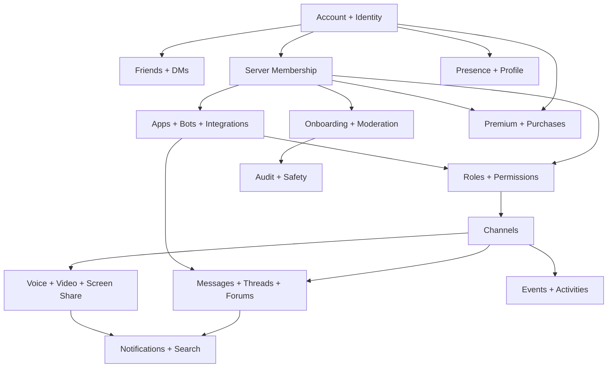
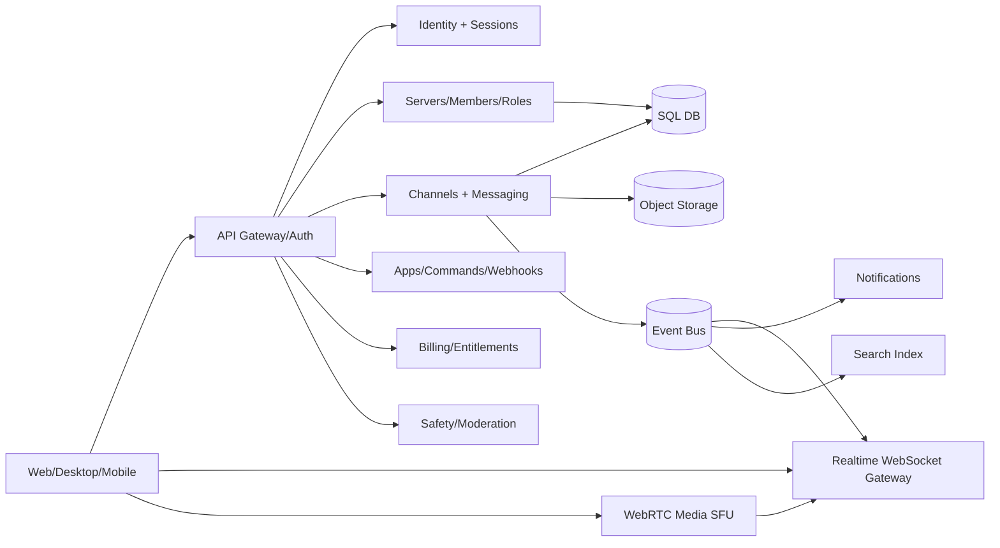

# Discord Feature & Interaction Specification

**Purpose:** Independent product implementation of Discord-like functionality, based on official Discord documentation.  
**Research date:** 2026-11-12  
**Primary sources:** [Discord Help Center](https://support.discord.com/hc/en-us/), [Discord Developer Documentation](https://docs.discord.com/developers/intro), [official developer documentation index](https://docs.discord.com/llms.txt).  
**Status:** Comprehensive public-documentation-based functional inventory and implementation blueprint; **not** a claim to have verified every article, every experimental feature, every internal algorithm, or every region/account-specific variant. Individual functionality and pricing can change.

> **Scope and legal boundary:** Re-create functionality with original branding, designs, code, and infrastructure. Do not copy Discord's logos, copyrighted graphics, proprietary source code, private APIs, or protected trade dress. Discord's public APIs are for integrating with Discord, not for exposing its private backend or reusing its licensed service independently. Use original implementations and comply with applicable laws and platform rules.

## 1. Reading guide

- **Documented:** publicly described in official help/developer pages linked below.
- **Design recommendation:** proposed data model, workflow, architecture, or acceptance test for an independent implementation; **not** an assertion about Discord's proprietary internals.
- **Conditional:** plan, platform, entitlement, community status, geographic eligibility, experiment, or permissions may affect access.
- Priority: **P0** foundation, **P1** core parity, **P2** advanced parity, **P3** optional/commercial/niche.

This file is deliberately organized by **product domain**, then **interactions**, **engineering contracts**, **flows**, **edge cases**, and **verification**. The official docs describe externally visible behavior and API objects, not an exhaustive blueprint for the Discord service.

## 2. Core product map

### 2.1 Entities and parent/child relationships

| Object | Links to | Critical behavior |
|---|---|---|
| User | credentials, sessions, profile, settings, friend edges, blocks | Stable user ID even after name changes |
| Server (guild) | owner, members, channels, roles, settings, integrations | Independent membership/security boundary |
| Membership | user + server + roles + nickname + join state | Member may have multiple roles; per-server identity |
| Role | server + priority + permissions | Role hierarchy affects management rights |
| Channel | server/DM group + type + category + overrides | Visibility, ordering, permission inheritance |
| Message | channel + author + content + references + attachments | Revisions, deletion, replies, reactions |
| Thread | parent channel/message + members + archival state | Separate conversation under parent context |
| Forum post | forum channel + thread + tags + starter message | Topic view organized as thread |
| Voice session | channel/call + participant states | Ephemeral membership and media streams |
| Invite | server/channel + creator + limits + expiry | Redeems to membership, subject to restrictions |
| Event | server + schedule + place/channel + RSVPs | Can lead into a live voice/stage session |
| App | owner + install contexts + commands + permissions | Third-party service interacts with resources |
| Webhook | channel/application + token/configuration | Inbound messages or outbound notifications |
| Subscription/entitlement | payer + product + validity + beneficiary | Enables perks and revocation on expiry |
| Audit/moderation record | actor + target + action + reason + time | Traceability and appeals |

**Design rule:** IDs are never display labels; authorization must happen on the server for every read, write, search result, notification, and media join.

## 3. Accounts, identity, profiles, sessions — P0/P1

**Official entry:** [Beginner's Guide](https://support.discord.com/hc/en-us/articles/360045138571-Beginner-s-Guide-to-Discord), [Account Settings category](https://support.discord.com/hc/en-us/), [Activity Sharing](https://support.discord.com/hc/en-us/articles/7931156448919-Activity-Sharing-on-Discord-FAQ).

**Inventory:** account registration and email verification; login/logout; password recovery; multi-factor authentication and backup recovery; session/device management; usernames versus display names; avatars, biographies, banners and profile effects; global and per-server nicknames/profiles; online/idle/do-not-disturb/invisible statuses; custom statuses; activity visibility and history; connected accounts; language, themes, accessibility, privacy and account deletion/export.

**Interactions:** identity ↔ memberships; profile permissions ↔ privacy; statuses ↔ friend/member lists; connected services ↔ rich presence; premium entitlements ↔ customization. On account disable or deletion, plan what happens to authored messages, memberships, friendships, integrations, and retained audit events according to your privacy policy.

**Recommended flow:** register → verify → choose profile → set privacy defaults → friend or join server → customize server-specific identity. Support simultaneous web/mobile/desktop sessions and token revocation.

**Edge cases:** renamed accounts, duplicate display names, user blocked by viewer, friend request privacy, revoked session, suspicious login, suspended account, unavailable cosmetics, different age-group restrictions.

## 4. Friends, direct messages, group messages — P0/P1

**Official:** [Friends list & getting started](https://support.discord.com/hc/en-us/categories/115000217151-Discord-Basics), [Mobile getting started](https://support.discord.com/hc/en-us/articles/360046618751-Getting-Started-on-Mobile).

**Inventory:** friend request send/accept/decline/cancel; friend list and presence filtering; remove friend; block/unblock; DM conversation creation; message requests and spam handling; DM safety settings; group DMs; add/remove participants (subject to membership rules); DM/group calls; invite friends to groups; pins/bookmarks where available; shared servers and profile links.

**Interactions:** account privacy gates requests; blocking gates delivery, mentions and presence; group membership gates history/media access; message requests separate unknown senders from the primary inbox; DMs reuse the message engine but have different authorization and notification rules.

**Model:** `friend_request(sender_id, recipient_id, status)`, `relationship(user_id, other_id, type)`, `conversation(type, owner_id?)`, `conversation_member`, `message`, `call`. Make relationship changes idempotent and explicit about user-facing effects.

**Acceptance:** two users can exchange/accept requests and chat; a rejected or blocked sender cannot bypass privacy controls through a stale client; group call member changes update all participant views.

## 5. Servers, ownership, discovery, invites — P0/P1

**Official:** [Server Setup Guide](https://support.discord.com/hc/en-us/articles/33023827550359-Discord-Server-Setup-Guide), [How to Join a Server](https://support.discord.com/hc/en-us/articles/360034842871-How-do-I-join-a-Server), [Server Features](https://support.discord.com/hc/en-us/sections/202857957-Server-Features), [Communities & Discovery](https://support.discord.com/hc/en-us/sections/360007770572-Communities-and-Discovery).

**Inventory:** create/delete server; server icon/name/description/banner/splash; server ownership and transfer; join/leave; server folder organization; server templates; server type/community enablement; server profile; server guides; server hub/student hubs or specialized experiences (conditional); member list; verification levels; public discovery and eligibility; invites with expiration and use limits; custom invites; pause invites; bans; membership screening and applications.

**Interactions:** invite → verification/rules screening → join membership → onboarding → role assignment → visible channel subset; community flags unlock community features; server features are subject to role-based management permissions; member removal must immediately revoke resources.

**Recommended invite states:** active / paused / expired / max-uses / revoked; redemption under transaction to avoid overuse. **Recommended membership states:** invited, pending screening, active, timed-out, kicked, banned, left.

## 6. Channels, categories, threads, forums, media — P0/P1/P2

**Official:** [Channels API](https://docs.discord.com/developers/resources/channel), [Threads FAQ](https://support.discord.com/hc/en-us/sections/202857957-Server-Features), [Discord Server Setup Guide](https://support.discord.com/hc/en-us/articles/33023827550359-Discord-Server-Setup-Guide).

| Channel type | User experience | Key relationships | Priority |
|---|---|---|---|
| Text | Continuous chronological chat, files, replies | message engine, permissions, notifications | P0 |
| Voice | Persistent room joined at will; optional accompanying text | participant state, RTC, permissions | P1 |
| Announcement | Publisher messages followed into other servers | cross-post subscriptions, moderation | P2 |
| Stage | Managed speakers and audience | speaker queue, stage roles, events | P2 |
| Forum | One thread per topic/post, tags, filtering | posts/threads, auto archive, permissions | P1 |
| Media | Visual post-first channel presentation | attachments + thread/post behavior | P2 |
| Category | Organizer/parent for related channels | ordering and permission sync | P0 |
| DM / group DM | Private conversation channels | relationship/member gates | P0 |
| Thread | Focused sub-conversation in a parent | membership, archive/lock, starter | P1 |

**Channel actions:** create, edit, move, reorder, delete, duplicate/sync permission configuration, set topic and NSFW/age restrictions, set slowmode, default notification settings, follow announcements, pin content and manage access. Thread actions: start from message/start standalone where supported, join/leave, archive/unarchive, lock/unlock, manage participants.

**Critical cross-feature rule:** channel access overrides parent/role defaults; the UI should not reveal content, unread counts, search snippets or media to unauthorized users. A thread's parent/access rules and explicit thread membership require careful evaluation.

## 7. Messaging and rich content — P0/P1

**Official:** [Discord Basics: Messaging & Chat](https://support.discord.com/hc/en-us/categories/115000217151-Discord-Basics), [Message API](https://docs.discord.com/developers/resources/message), [Poll API](https://docs.discord.com/developers/resources/poll).

**Inventory:** compose/send/edit/delete; multiline input; mention people/roles/everyone/here subject to permissions; replies and message jump links; markdown-style formatting, inline and block code, spoilers, quotes; attachment upload/download; drag/drop; embedded images/videos, links and previews; GIFs; emoji; custom emoji; stickers; reactions and super reactions; polls and voting; pin/unpin; copy link/forward; message history and pagination; typing indicators; message search; link previews; unread markers; bookmarks/reminders where applicable; message context menus; threaded replies; text-to-speech/translation where supported or implemented separately.

**Design recommendation:** separate immutable message ID from mutable revisions; store markdown source + sanitized render metadata; media in object storage with signed URLs; attachments undergo malware/content checks; embed fetching runs server-side with SSRF protections; search index updates asynchronously but must enforce access at query time.

**Event flow:** client optimistic send → server validates permissions, length, rate limits and uploads → append durable message → publish create event → update unread counters/mentions → fan-out notifications → index searchable text. Editing/deleting causes corresponding revision/remove events and updates previews/search/references.

**Poll flow:** create choices + optional expiration → record per-user votes under configured rules → display aggregate and voters according to product policy → close automatically or by privileged actor.

**Edge cases:** messages sent after role removal, attachment upload interrupted, concurrent edits/deletes, deleted reply targets, rate limits, spoiler previews, duplicate sends on reconnect, custom emoji from unavailable server, mention suppression and slowmode.

## 8. Voice, video, streams and activities — P1/P2

**Official:** [Voice/Video/Streaming articles](https://support.discord.com/hc/en-us/sections/201110537-Voice-Video-and-Streaming), [Voice API](https://docs.discord.com/developers/topics/voice-connections), [Activities overview](https://docs.discord.com/developers/platform/activities).

**Inventory:** direct/group calls; join/leave voice channels; user mute/deafen; server mute/deafen; push-to-talk and voice activity; input/output device selection, suppression/noise cancellation and mic test; regional voice routing; video calls; camera controls; screen/application sharing and Go Live; multiple concurrent streams/viewers (conditional); video backgrounds; screen share on desktop/mobile; soundboard; priority speaker; stage audience/speaker transitions; streams clips and overlays; activities launch/join/invite.

**Interactions:** participants must be authorized to connect and separately authorized to speak/video/stream where relevant; voice presence appears in channel/member lists; a streaming session produces UI badges and join targets; stage roles connect moderator permissions to speaker state; activity invitation connects messaging, voice and app capabilities.

**Independent implementation recommendation:** WebRTC SFU architecture for many-party voice/video, STUN/TURN, signaling gateway, media session coordinator, bandwidth/quality adaptation, browser capture permission workflows, media moderation controls, recording only with explicit consent/legal basis. Don't mistake Discord's bot voice API for the full internal client media architecture.

**Acceptance:** reconnect to same live room; revoke access mid-call; device change; simultaneous speaking; mobile background lifecycle; screen share start/stop; user server-muted cannot speak; notify users of relevant participant changes.

## 9. Permissions, roles and channel overrides — P0 architectural prerequisite

**Official:** [Permissions API](https://docs.discord.com/developers/topics/permissions), [Roles, Permissions and Moderation](https://support.discord.com/hc/en-us/sections/202856377-Roles-Permissions-and-Moderation).

**Core concepts:** server owner; default `@everyone` role; multiple assigned roles; role order/hierarchy; server-level permission bitset; channel/category explicit allow/deny overwrites for roles and members; administrator-level bypass with appropriate safeguarding; role-scoped mention controls; channel-specific app command permissions; role management bounded by hierarchy.

**Implementation:** central `evaluatePermission(user, server, channel, action)` used on **every** API, media service, search, file download, websocket subscription and moderation tool. Evaluate ownership, membership, timeouts, global role bits, channel overwrites and context-specific restrictions in a documented order. Never rely on hiding UI actions for security.

**Permission families:** view/manage channels, send/read message history, add reactions, embed links, attach files, mention roles, create/manage threads, connect/speak/stream/video, voice moderation, manage roles/server/webhooks, kick/ban/timeout/moderate members, manage events and server insights.

**Test matrix:** roles A+B with conflicting overwrites; default-role denial vs explicit user grant; category unsynced child; role hierarchy change; removal of last privilege; thread visibility; webhook authorization; stale websocket after permission downgrade; server owner exceptions; administrator powers; bot command access.

## 10. Community onboarding, discovery and events — P1/P2

**Official:** [Communities & Discovery](https://support.discord.com/hc/en-us/sections/360007770572-Communities-and-Discovery), [Server Features](https://support.discord.com/hc/en-us/sections/202857957-Server-Features), [Events API](https://docs.discord.com/developers/resources/guild-scheduled-event).

**Inventory:** community conversion, rules channel and announcements channel, member rules screening, onboarding questions with role/channel assignment, server guide and welcome content, public discovery pages, server insights, web discoverability, membership applications, scheduled events with title/time/location/cover/description, interested-member RSVP, event reminders and live launch, stage sessions.

**Flows:** join → rules acceptance → onboarding choice → auto role/channel assignments → guide → notification; create event → RSVP → reminder → live room/stage → end event. Availability and eligibility may vary by server type and rollout.

**Data:** onboarding question/options and `role_grants`, `channel_grants`, `event`, `event_interest`, `event_status`, `reminder_delivery`; maintain idempotency.

## 11. Moderation, trust, safety and parental controls — P0/P1/P2

**Official:** [Moderation articles](https://support.discord.com/hc/en-us/sections/202856377-Roles-Permissions-and-Moderation), [Family Center](https://support.discord.com/hc/en-us/articles/14155043715735-Family-Center-for-Parents-and-Guardians), [Age assurance](https://support.discord.com/hc/en-us/articles/30326565624343-How-to-Complete-Age-Assurance-on-Discord).

**Inventory:** verification levels, rule acceptance, auto moderation for specified trigger patterns, blocked terms/links and anti-spam, safety alerts; report message/user/server; moderator queue; delete messages; warn, timeout, kick and ban; invite restrictions, raid protection and security actions; audit logs; review membership, role and integration actions; NSFW/age-restricted access; blur/block sensitive media; block user and restrict DM access; data privacy controls; parental/family center with opt-in linking, summaries and limited setting management; screen downtime where available.

**Interactions:** auto moderation hooks into message ingress before delivery; timeouts connect to the permission engine; actions are recorded in audit logs and notification flows; reporting should preserve evidence while respecting privacy; age assurance gates age-restricted spaces/settings; parental features must be explicitly scoped to safeguards and consent rather than displaying private message bodies.

**Security design:** human review for consequential automated actions; abuse rate limits, appeals, evidence preservation with retention controls, legal process workflows, data minimization and access auditing. Account- and country-specific rules must remain configurable.

## 12. Notifications, activity feed, search and navigation — P0/P1

**Official:** [Discord Basics](https://support.discord.com/hc/en-us/categories/115000217151-Discord-Basics), [Activity Sharing](https://support.discord.com/hc/en-us/articles/7931156448919-Activity-Sharing-on-Discord-FAQ).

**Inventory:** unread markers, last-read cursor, mention badge counts, desktop/mobile push, in-app inbox, mute servers/channels/threads, notification level overrides, suppression of @everyone/role mentions, message and event alerts, desktop notification settings, activity cards and friend activity, quick switcher, server folders, channel hide/collapse, comprehensive message search and filters, keyboard shortcuts, accessibility navigation.

**Interaction:** `message_created` updates channel unread state and pushes only if member has permission and preference allows; friend presence only visible under privacy rules; event subscriptions trigger reminder events; read cursors sync across devices. Search must support server/channel/user/date/content filters where implemented and never leak hidden content.

## 13. Bots, apps, slash commands, components, webhooks — P2

**Official:** [Apps overview](https://docs.discord.com/developers/quick-start/overview-of-apps), [Interactions](https://docs.discord.com/developers/interactions/overview), [Components](https://docs.discord.com/developers/components/overview), [Webhooks](https://docs.discord.com/developers/platform/webhooks), [Gateway](https://docs.discord.com/developers/events/gateway), [Using Apps](https://support.discord.com/hc/en-us/articles/21334461140375-Using-Apps-on-Discord).

**Inventory:** developer application creation; bot identity; server-installed and user-installed apps; OAuth2 authorization/grants/scopes; application commands (slash, user and message context menu); command registration and permission checks; autocomplete; buttons, select menus and modal forms; deferred responses and ephemeral replies; webhook channel posting and webhook events; app directory/discovery; command usage in DMs/servers; intent subscriptions; Gateway events and reconnect; rate limits and token security; embedded Activities; linked roles and account metadata; app-level monetization.

**Interactions:** app installation → permission/scope consent → commands available in allowed locations → interaction dispatch → response message/modal/update → optional follow-up; webhook event → signature check → app process → reply or external side effect; bot events → event gateway → app worker. Developer docs describe *integration contracts with Discord*, so a Discord-like service must create **its own** bot platform and developer contracts.

**Platform engineering:** developer console, API key/secret lifecycle, OAuth authorization server, app installation database, permission grants, commands registry, execution callback with deadlines/retry semantics, secure component IDs, interaction signatures, gateway resume/replay, event subscription/intents, throttling and app review.

## 14. Rich presence, games, app integration and social layer — P2/P3

**Official:** [Rich Presence](https://docs.discord.com/developers/platform/rich-presence), [Social Layer](https://docs.discord.com/developers/platform/social-layer), [Game Profiles](https://docs.discord.com/developers/platform/game-profiles), [Activity Sharing](https://support.discord.com/hc/en-us/articles/7931156448919-Activity-Sharing-on-Discord-FAQ).

**Inventory:** game/application detection, active activity display, game invites/join requests, elapsed time and party status, account linking and privacy gating, music listening status, game profiles, shared multiplayer activities; game SDK integration (as supported). Recent activity history is conditional on visibility settings.

**Interaction:** external game ↔ authenticated activity session → presence events → visible profile/card → eligible join target; explicit connection scopes and per-user sharing controls gate display. Don't assume users wish to reveal installed/running software.

## 15. Premium, boosts, server subscriptions, shops, quests — P3

**Official:** [Nitro/Nitro Basic](https://support.discord.com/hc/en-us/articles/115000435108-What-are-Nitro-Nitro-Basic), [Nitro category](https://support.discord.com/hc/en-us/categories/360001025912-Nitro), [Shop FAQ](https://support.discord.com/hc/en-us/articles/17162747936663-Shop-FAQ), [Quests FAQ](https://support.discord.com/hc/en-us/articles/22225719947543-Discord-Quests-FAQ), [Communities](https://support.discord.com/hc/en-us/sections/360007770572-Communities-and-Discovery).

**Inventory:** subscription tiers; cosmetics, larger upload sizes, longer messages and higher media quality entitlements; server boosts and unlock tiers; gifts/redeemable codes; premium membership/subscriptions for communities; storefront and cosmetics (avatar decoration, frames, profile effects, nameplates); purchases, discounts, bundles, gifting; app monetization, recurring subscriptions and one-time in-app products; quests linked to playing/streaming/watching and reward claiming; points/Orbs reward store; billing, refunds, cancellations and invoices.

**Interactions:** purchase → payment-provider webhook → verified entitlement → feature gates/UI state; gift/redeem → transfer entitlement → anti-fraud constraints; server boost → benefit recalculation → channel/media capability changes; quest acceptance → verified telemetry/progress → reward entitlement; withdrawal/expiry/refund → revocation and graceful fallbacks.

**Avoid copying:** Discord-specific commercial catalogs, pricing, campaign creative, protected branding and partner agreements. Rebuild a generic entitlement/billing framework with original content.

## 16. UX, clients and accessibility — P1/P2

**Documented surfaces:** browser, desktop and mobile with platform-specific differences. Settings categories, desktop keyboard shortcuts, quick switcher, appearance/themes, accessibility/reduced motion, responsive navigation, desktop game overlay, mobile voice overlays and streaming controls.

**Suggested desktop layout:** server rail | category/channel navigation | message/conversation content | context/members rail | persistent composer/call controls. **Suggested mobile layout:** server/channel navigation, chat, member/context sheet, call overlay and notifications. These are design references, not permission to reproduce proprietary artwork.

**UX behaviors:** channel switching preserves draft where chosen; unread and jump-to-message affordances; focus/keyboard navigation; high contrast, screen-reader labels, reduced motion; uploading progress and retries; reconnect banners; fine-grained notification controls; loading/empty/error states.

## 17. Feature-to-feature dependency matrix

| Feature | Depends on | Publishes/affects | Most important permission/privacy check |
|---|---|---|---|
| Create server | identity | membership, default roles/channels | account can create |
| Redeem invite | user, invite, screening | membership, onboarding | bans, expiry, capacity |
| Onboarding answer | membership, option set | role membership, channel visibility | question/role constraints |
| Role assignment | role hierarchy, membership | channel list, actions, bot eligibility | manage roles + hierarchy |
| Channel creation | server, permissions | navigation, permissions, notification | manage channels |
| Message send | channel, membership | websocket, unread, search, push | send message + slowmode |
| Mention | message + target | notification, mention counter | permission to mention |
| Thread/forum post | parent channel | thread view, indexing, subscription | view + thread creation |
| Voice join | voice channel | speaking state, member list | connect and channel access |
| Screen share | active voice/call | video UI, view sessions | streaming permission |
| Schedule event | community/server | RSVP, reminders, voice/stage | manage events |
| Bot installation | app, OAuth, server | commands, member presence, roles | user install rights and scopes |
| Slash command | installed app + command | interaction, result message | context and command permission |
| Moderation timeout | privileged actor/member | restrict messages/voice, audit | moderate members + hierarchy |
| Search | indexed messages | search UI | live authorization |
| Premium purchase | account/payment/product | entitlements, limits, cosmetics | verified transaction |
| Quest reward | campaign + activity | wallet, entitlement | eligibility/progress verification |

## 18. Reference event contracts (proposed for a replica)

| Event | Producer | Consumers |
|---|---|---|
| `account.updated` | identity service | profiles, gateway, search metadata |
| `membership.joined/left` | server service | permissions, channel cache, notifications |
| `role.membership_changed` | authorization service | permission invalidation, gateway subscriptions |
| `channel.created/updated/deleted` | channel service | navigation cache, search, audit |
| `message.created/updated/deleted` | chat service | gateway fanout, unread, search, moderation |
| `reaction.changed` | chat service | reaction counts and realtime UI |
| `thread.created/archived` | channel service | listings, subscriptions, search |
| `voice.participant_changed` | media coordinator | presence and client UI |
| `event.scheduled/started/ended` | event service | reminder worker and server UI |
| `moderation.action_recorded` | trust service | enforcement, audit, appeals |
| `app.interaction_requested` | app platform | dispatcher and response service |
| `entitlement.activated/expired` | billing service | capability limits, UI, cosmetics |

**Contracts must include:** event ID, aggregate ID, actor, UTC timestamp, version, trace ID, idempotency key and bounded retry/dead-letter policy. Never place private or unnecessarily sensitive content on broadly accessible event topics.

## 19. Suggested service architecture (independent design, not Discord's internals)

### 19.1 Practical stack options

- **Backend:** Rust, Go, Node.js/TypeScript or another team-supported stack; favor operational competence over language fashion.
- **State:** relational database for transactions/memberships/roles/messages; Redis-compatible cache for presence/rate-limits; search index for messages; object storage for media.
- **Realtime:** WebSocket gateway with heartbeats, reconnect/resume, sequence IDs, room subscriptions, backpressure and deduplicated events.
- **Media:** WebRTC SFU and TURN; don't stream high-volume audio/video through the general chat event gateway.
- **Jobs:** durable queue for notification delivery, indexing, previews, moderation, expiring events and entitlements.
- **Security:** OAuth/OIDC and/or first-party sessions, rotated credentials, MFA, signed uploads, audit logging, comprehensive policy checks.
- **Clients:** browser and responsive application; optional desktop wrapper and mobile native/hybrid implementation.

### 19.2 Nonfunctional requirements

Availability and recovery targets; message durability; low-latency delivery and acknowledgments; horizontal gateway scale; file scanning; abusive traffic controls; session security; encryption at rest and TLS; data retention/deletion; regional compliance; observability and tracing; backup/restore drills; accessibility standards; cost controls for video/storage.

## 20. Functional acceptance scenarios (end-to-end)

1. **Invite/onboard/chat:** A creates server → configures channels/roles → sends expiring invite → B joins/screening → chooses onboarding role → sees only permitted channels → sends first message → A receives notification.
2. **Permission revocation:** B is viewing a private channel → admin removes role → permission cache invalidates → history/search/download/WS are denied; UI removes channel.
3. **Forum activity:** B posts topic with tags → C replies → B subscribes/receives allowed notifications → moderator locks/archive → new replies denied.
4. **DM safety:** stranger DMs B → request inbox/filters handle it → B blocks sender → subsequent delivery and related interactions respect policy.
5. **Voice/screenshare:** multiple permitted users join voice → one screenshares → viewers can subscribe → admin server-mutes a member → member cannot publish audio → stream ends gracefully.
6. **App command:** developer registers `/poll` → admin installs app → user triggers command → app responds with a component → clicks update results with authorization.
7. **Moderation:** message triggers spam rule → action blocked or flagged → moderator reviews → timed-out member cannot post → enforcement and audit record reconcile.
8. **Event:** member schedules event → interested members RSVP → reminder delivered once → live stage launches → event ends and archived information remains.
9. **Subscription:** user purchases tier → verified payment grants higher upload limit → cancellation runs to paid-through date → entitlement expires → account keeps historical messages without letting user bypass current upload gates.
10. **Multi-device:** same user logs in on desktop/mobile → sends/edit/deletes messages → both clients converge → read state/notifications are reconciled → reconnect uses event cursor.

## 21. Build roadmap and prerequisites

| Phase | Implement | Completion gate |
|---|---|---|
| 0. Product decisions | tenancy, supported devices, privacy/retention, accessibility, original brand | written requirements and threat model |
| 1. Foundation (P0) | auth/sessions, users, server/member, roles/permissions, channel CRUD, API, WebSocket | security test matrix + multi-device login |
| 2. Core chat (P0) | messages, DMs, friends, history, replies, file upload, reactions, unread, notifications | comprehensive end-to-end message flows |
| 3. Community chat (P1) | threads, forums, invites, onboarding, moderation, search, channel types | join/onboard/revoke and search tests |
| 4. Live communication (P1) | voice, calls, video, screen share, voice permissions | cross-device media/reconnect tests |
| 5. Advanced community (P2) | stage, announcements, events, server discovery, server analytics | event, cross-post and community workflows |
| 6. Developer platform (P2) | apps, bots, command registry, OAuth, components, webhooks, developer UI | reference app + permission tests |
| 7. Gaming integrations (P2) | activity, presence, account linking, SDK hooks | game session joins + privacy tests |
| 8. Monetization (P3) | tiers, boosts, cosmetics, gifts, shop, app sales, rewards/quests | transaction and entitlement reconciliation |
| 9. Operational parity | abuse detection, safety tooling, localization, support, accessibility, performance | reliability, legal, load and accessibility audits |

**MVP recommendation:** Start with phases 0–3. Chat, access control, onboarding and notifications are tightly coupled; attempting Nitro-style commerce or full voice parity first increases cost and instability.

## 22. Official source directory and verification checklist

### 22.1 User-facing help-center collections

- [Help Center root](https://support.discord.com/hc/en-us/)
- [Discord Basics](https://support.discord.com/hc/en-us/categories/115000217151-Discord-Basics)
- [Getting Started](https://support.discord.com/hc/en-us/sections/360008206871-Getting-Started)
- [Server Settings](https://support.discord.com/hc/en-us/categories/200404378-Server-Settings)
- [Server Features](https://support.discord.com/hc/en-us/sections/202857957-Server-Features)
- [Roles, Permissions and Moderation](https://support.discord.com/hc/en-us/sections/202856377-Roles-Permissions-and-Moderation)
- [Communities and Discovery](https://support.discord.com/hc/en-us/sections/360007770572-Communities-and-Discovery)
- [Voice, Video and Streaming](https://support.discord.com/hc/en-us/sections/201110537-Voice-Video-and-Streaming)
- [Nitro, Boosting and Shop](https://support.discord.com/hc/en-us/categories/360001025912-Nitro)
- [Nitro feature comparison](https://support.discord.com/hc/en-us/articles/115000435108-What-are-Nitro-Nitro-Basic)
- [Shop](https://support.discord.com/hc/en-us/articles/17162747936663-Shop-FAQ)
- [Quests](https://support.discord.com/hc/en-us/articles/22225719947543-Discord-Quests-FAQ)
- [Family Center](https://support.discord.com/hc/en-us/articles/14155043715735-Family-Center-for-Parents-and-Guardians)
- [Age assurance](https://support.discord.com/hc/en-us/articles/30326565624343-How-to-Complete-Age-Assurance-on-Discord)

### 22.2 Developer references

- [Developer docs index (machine-readable)](https://docs.discord.com/llms.txt)
- [Developer portal overview](https://docs.discord.com/developers/intro)
- [API reference](https://docs.discord.com/developers/reference)
- [Permissions](https://docs.discord.com/developers/topics/permissions)
- [Channel resource](https://docs.discord.com/developers/resources/channel)
- [Message resource](https://docs.discord.com/developers/resources/message)
- [Guild resource](https://docs.discord.com/developers/resources/guild)
- [User resource](https://docs.discord.com/developers/resources/user)
- [Gateway](https://docs.discord.com/developers/events/gateway)
- [Gateway events](https://docs.discord.com/developers/events/gateway-events)
- [Interactions](https://docs.discord.com/developers/interactions/overview)
- [Components](https://docs.discord.com/developers/components/overview)
- [Webhooks](https://docs.discord.com/developers/platform/webhooks)
- [Auto moderation](https://docs.discord.com/developers/resources/auto-moderation)
- [Scheduled events](https://docs.discord.com/developers/resources/guild-scheduled-event)
- [Polls](https://docs.discord.com/developers/resources/poll)
- [Social SDK](https://docs.discord.com/developers/platform/social-layer)
- [Activities](https://docs.discord.com/developers/platform/activities)
- [Monetization](https://docs.discord.com/developers/monetization/overview)

### 22.3 Verification and coverage status

| Coverage class | Status | Caveat |
|---|---|---|
| Help Center main categories and named feature pages | **Surveyed** | Category listing is not a complete archive; some articles updated independently |
| Developer documentation index and major API domains | **Surveyed** | Index is broad, but this document is not a line-by-line transcription of every endpoint |
| Cross-feature architecture and flows | **Designed/inferred** | Proposed replication blueprint, not Discord internal infrastructure |
| Exact hidden logic, moderation scoring, matchmaking/quests fraud algorithms | **Not publicly verified** | Build independently and test desired behavior |
| Experiment/A-B/region/Nitro-specific availability | **Conditional** | Verify against live account/platform when implementing |
| All current platform-specific screenshots and tap-by-tap flows | **Not exhaustively audited** | Requires hands-on UI audits and further per-article review |
| Latest pricing and numeric limits | **Intentionally not hardcoded** | Should be feature flags/config values and verified at release time |

## 23. Follow-on documentation packs for implementation teams

For a truly build-ready reproduction, split this inventory into these versioned specs:

1. `01_DOMAIN_MODEL.md` — entities, keys, indices, migrations, invariants.
2. `02_PERMISSION_ENGINE.md` — exhaustive role/override precedence, truth table, abuse tests.
3. `03_MESSAGING_PROTOCOL.md` — REST/WS endpoints, events, pagination, media uploads, retries.
4. `04_SERVER_AND_ONBOARDING.md` — configuration steps, lifecycle state machines, invite/review roles.
5. `05_VOICE_VIDEO_RTC.md` — signaling, SFU, TURN, devices, quality and failure handling.
6. `06_BOT_AND_APP_PLATFORM.md` — OAuth, commands, installation, webhooks, interactive forms.
7. `07_SAFETY_AND_MODERATION.md` — enforcement, appeals, evidence, age and privacy.
8. `08_MONETIZATION.md` — billing, entitlements, boosts, products, gifting and rewards.
9. `09_CLIENT_UX.md` — desktop/mobile flows, screen inventory and accessibility.
10. `10_TEST_MATRIX.md` — contract, unit, integration, security, E2E and scale tests.

**Bottom line:** This document is a **large organized baseline**, covering the major documented Discord capability families and how to connect them in an independent implementation. It is **not** a proof of feature-for-feature exact parity or of exhaustive crawling of every Discord article. Use it as the product index and roadmap, then expand each subsystem to executable specifications and review Discord's live UI for behavior that the documentation does not define.
