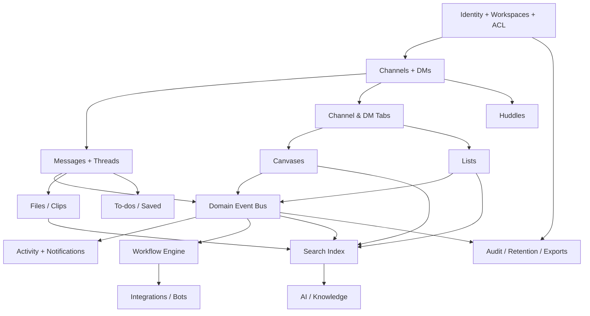
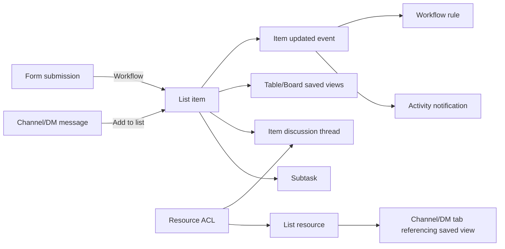

# Slack Functionality Replication — Master Research & Implementation Specification

**Research date:** 2026-11-12  
**Source policy:** Official Slack Help Center, Slack product pages, and official Slack developer documentation; URLs included throughout.  
**Objective:** Design an independent, Slack-inspired collaboration application with comparable workflows and interoperability between modules.  
**Status:** Broad official-documentation survey and implementation blueprint; **not** a claim that every Slack help article, every tier-specific edge case, or private implementation detail has been exhaustively crawled.  
**Legend:** **[D]** behavior documented by Slack; **[P]** recommended implementation/parity design; **[V]** needs hands-on verification for pixel-level or edge-case parity. 

> **Important:** Slack’s branding, text, proprietary illustrations, private APIs, and exact visual trade dress are not deliverables to copy. Implement comparable independently designed functionality. Slack features change frequently, and availability differs by paid tier, administrator policy, client platform, and region. Review each source again before implementation.

## Contents
1. Product taxonomy and cross-feature graph
2. Workspace, identity, membership, and navigation
3. Channels, conversations, messaging, and threads
4. Notifications, Activity, To-dos, Saved, and reminders
5. Files, clips, huddles, and media
6. Canvases and channel resource tabs
7. Lists — complete feature specification and interactive prototype
8. Workflow Builder and event automation
9. Search, directory, and knowledge discovery
10. External collaboration / Slack Connect
11. Apps, bots, integrations, and platform API
12. AI, Slackbot, enterprise search, Salesforce
13. Admin, compliance, security, billing, analytics
14. Cross-feature user journeys and event contracts
15. Architecture, entities, authorization, and scaling
16. Screen inventory and interaction specifications
17. Delivery roadmap, quality gates, and test matrix
18. Source catalog and gaps for subsequent verification

---

# 1. Product taxonomy and cross-feature graph

Slack documents collaboration through channels, messaging, Slack Connect, huddles and clips; project management through canvases, Lists, files and templates; automation through workflows and integrations; intelligence through AI/agents and enterprise search; and an enterprise administration layer. [D] [Product overview](https://slack.com/features) | [Plans & features](https://slack.com/help/articles/115003205446-Slack-plans-and-features).

**Subsystem inventory**

| ID | Subsystem | Primary capabilities | Major dependencies | Baseline priority |
|---|---|---|---|---|
| WSP | Organizations/workspaces | tenancy, member invites, roles, preferences, governance | identity, ACL, audit | Foundation |
| NAV | Navigation | Home, channels, DMs, Activity, Files, To-dos, agents/tools, search | all data modules | Foundation |
| CHN | Channels | public/private, membership, topic, description, channel tabs, templates | WSP, MSG, ACL | P0 |
| DM | Direct/group messages | conversation creation, participants, permissions, Slack Connect DM | WSP, MSG | P0 |
| MSG | Messaging | rich compose, replies, edits, deletion, mentions, reactions, pins, schedule | CHN/DM, notifications, search | P0 |
| ACT | Activity | unified inbox, filters, saved views, read/clear/VIP | event stream, MSG, workflow | P0 |
| TODO | Personal To-dos/Saved | create to-do from message/file, reminders, complete/clear, bookmark | MSG, FILE, ACT | P1 |
| FILE | Files | upload, download, previews, links, retention, search | MSG, storage, ACL | P0 |
| HUD | Huddles | ad-hoc live audio/video, screen share, notes | CHN/DM, realtime/media | P2 |
| CLIP | Clips | short audio/video recordings, transcripts, replies | FILE, MSG | P2 |
| CAN | Canvases | rich document, embedded media, checklist, comments, mentions | FILE, ACL, ACT | P1 |
| LST | Lists | typed fields, tasks/subtasks, views, board/table, comments, form intake | FILE, CHN tabs, WF, ACL | P1 |
| WF | Workflows | triggers, steps, variables, buttons, forms, integrations | event bus, all modules | P1/P2 |
| SRC | Search | cross-entity lookup, modifiers, permission-filtered indexes | all persisted content | P1 |
| EXT | External collaboration | secure cross-org channels and DMs | federated membership/ACL | P3 |
| APP | Marketplace & app platform | OAuth, bots, app permissions, webhooks, slash commands | API gateway, WF | P2/P3 |
| AI | AI and agents | summaries, recap, search answers, meeting notes, AI workflows | permission-filtered retrieval | P3 |
| ADM | Governance | audit, retention, export, DLP, SSO, SCIM, analytics | identity, events, storage | P1/P3 |

**Core dependency sketch (proposed)**



**Critical architecture principle [P]:** a message, task, canvas, file, or workflow run is a uniquely addressable resource with an ACL, audit trail, persistent link, and generated events. Tabs and search refer to resources; they do not duplicate the underlying content.

# 2. Workspace, identity, membership, and navigation

## 2.1 Workspace and membership

**[D]** Slack organizes work into workspaces and, on enterprise offerings, organizations with administrative controls. Members collaborate within channels and DMs; admins can manage roles, join/invite behavior, and features. **[P]** Support organization → workspace → member membership; one account may belong to multiple workspaces; explicit active workspace context; membership join/leave states; guest and external memberships; identity and tenant separation.

**Recommended user flow:**
1. User signs up or authenticates; creates or joins a workspace.
2. Workspace admin specifies name, domain/invite rules, default channels, and policy.
3. Invited user accepts; member is added to default channels and appears in directory.
4. Member profile has name, photo, title, time zone, status, pronouns (optional), and availability.
5. Permission changes immediately affect list/canvas/channel/search access and integrations.

**Implement:** owner/admin/member/guest/service-account roles; customizable roles only after primitive permissions exist; user groups; membership invitations and expiration; workspace preferences; status and availability; session management; logged membership changes; account deactivation and data policy.

## 2.2 Navigation

**[D]** Current interface includes Home, DMs, Activity, Files, To-dos, and Agents & tools (or Tools on some clients); global search, create controls, profile preferences. Channels, canvases, lists, workflows and apps have navigational entry points. [Quick start](https://slack.com/help/articles/360059928654-How-to-use-Slack--your-quick-start-guide/).

**[P]** Navigation should preserve context, support unread badges, command palette, keyboard shortcuts, back/forward deep links, starred items, collapsible sections, multi-window support where appropriate, and clear mobile adaptations.

# 3. Channels, conversations, messaging, and threads

## 3.1 Channels

**[D]** Create a channel through sidebar `+` → Channel → blank or template → name → public/private → Create. Channels group people, files, messages, canvases, lists and workflows. Channel creation rights can be constrained by workspace owners. [Create a channel](https://slack.com/help/articles/201402297-Create-a-channel) | [Keep work organized](https://slack.com/help/articles/1500000019361-Keep-work-organized-with-channels).

**Channel feature checklist [P]:**
- Public / private channel classification; default/general channel behavior; invite/join/leave; channel topic, description, owner/managers.
- Members, guests, and notification settings; archived and active states; channel rename; channel-specific posting and retention permissions.
- Message stream, threads, mentions, shared files, pinned messages, tabs, resource folders, canvas/list references.
- Channel templates that can instantiate a bundle of resources and starter automations.
- Channel list/sidebar sorting, custom sections, stars, unread counters and per-user hide/mute state.
- Access tests across join, leave, archival, role changes and re-invitation.

## 3.2 Direct messages

**[D]** DMs support individual and small-group conversations; can launch huddles. Group DMs can be converted to private channels under supported conditions. External DM support uses Slack Connect. [Using Slack topic index](https://slack.com/help/categories/200111606).

**[P]** Canonical conversation identity (do not create multiple 1:1 DM threads for the same member pair); group memberships and history rules; request/accept gates for outside organization contacts; member status, permissions, deep links and unread state.

## 3.3 Messaging, composer and threads

**[D]** Slack offers composition, formatting, mentions, emoji reactions, scheduled messages, threads, editing/deleting messages, forwarding, file attachments, GIFs, code snippets, links and previews. [Collaborating in channels](https://slack.com/help/articles/360058495654-Collaborate-effectively-in-channels) | [Using Slack index](https://slack.com/help/categories/200111606).

**Suggested detailed interaction contract [P]:**
1. Open a channel/DM and load paginated messages chronologically, retaining read cursor.
2. Compose text with rich blocks (bold, italic, lists, quote, code, link); autocomplete `@member` and channel references.
3. Upload attachments as pending artifacts; submit atomically or show retry state.
4. On send, server assigns immutable ID, author, creation time, and parent-thread ID if reply; publishes `message.created`.
5. A thread panel shows parent and reply chain; reply updates thread activity and relevant subscribers.
6. Reaction toggles are idempotent per user/message/emoji; `message.reaction_added` can launch a workflow.
7. Edit keeps revision/audit history according to policy; deletion is authorized and reflected in search, notifications and saved links.
8. Schedule send uses user time zone plus absolute execution timestamp; support rescheduling/cancel.
9. Forward/share preserves provenance and enforces original content visibility; do not expose private text by unauthorized link previews.

**Important invariants:** private channel/DM access enforced server-side; removed users cannot retrieve protected message bodies; read markers per user per conversation, not global; message/thread edits refresh search and notifications; attachments obey same or stricter access policy than their container.

# 4. Notifications, Activity, To-dos, Saved and reminders

## 4.1 Activity unified inbox

**[D]** Activity presents DMs, mentions, threads, reactions, channel notifications, invitations, app updates, reminders, VIPs, and custom views; supports dense/detailed modes, read/clear, filters and quick reply. [Activity](https://slack.com/help/articles/19693583638803-Get-your-work-done-from-the-Activity-view).

**Interaction flow:** event occurs → notification eligibility (subscription, mention, user preferences, quiet hours, membership, self-authored suppression) → durable inbox record → badge count/push/email delivery → user opens, reads, clears or replies. Clearing hides the notification from the main inbox rather than destroying its source event. [P]

**[P]** Track `notification_event`, `notification_delivery`, and `user_notification_state` separately to prevent duplicates, support multiple devices, bulk clear and read/unread changes. Include user-configurable per-channel notification levels and do-not-disturb status.

## 4.2 To-dos versus the old Later feature — 2026 change

**[D]** Starting in **October 2026**, Slack began replacing **Later** with **To-dos** and **Saved**. A message/file can become a personal to-do; users can manually create a to-do, optionally set a reminder, complete or clear it, filter by status and reminder state, and sort by date. Prior saved items without reminders migrated to Saved in Home. [Later is now To-dos](https://slack.com/help/articles/55757634348435-Later-is-now-To-dos).

**[P]** Implement **two independent concepts**: (a) personal actionable `Todo` with optional due/reminder and completion; (b) bookmarked `SavedReference` for content retrieval. Do not collapse team-wide Lists into personal To-dos. `Todo.source_resource_id` may refer to a message/file/list item, but the original source continues to exist.

## 4.3 Reminder engine

**[P]** Store time zone, repeat rule, next delivery, cancellation and completion status; emit reminders into Activity; allow per-user quiet-hour handling; ensure idempotency on scheduler retries; avoid sending after user loses access.

# 5. Files, clips, huddles and media

## 5.1 Files

**[D]** Users attach files in conversations, browse shared content, interact with file previews and search. Files are linked to channel or DM context; Files area also contains canvases and lists. [Quick start](https://slack.com/help/articles/360059928654-How-to-use-Slack--your-quick-start-guide/) | [Using Slack topic index](https://slack.com/help/categories/200111606).

**[P]** Implement object storage + metadata + upload sessions + antivirus and content validation + access-controlled downloads + previews and thumbnails + file size/type constraints + signed short-lived download URLs + deduplication optional. Add upload progress, cancel, retry, drag-drop, copy links, sort/filter by owner/type/date, search indexing where permissible, link previews and alt text.

## 5.2 Clips

**[D]** Slack supports short audio/video clips in channels and DMs, replies in threads, video screen recording, optional transcript generation, playback and deletion governed by file retention policy. Documentation describes clips up to five minutes. [Record clips](https://slack.com/help/articles/4406235165587-Record-audio-and-video-clips-in-Slack).

**[P]** Media recording permissions, server ingestion, transcoding, transcript job, caption accessibility, thumbnails, playback progress, attachment references and thread association.

## 5.3 Huddles

**[D]** Huddles are live collaboration sessions associated with channels or DMs and include audio/video, screen sharing and AI note capabilities on eligible plans. [Slack features](https://slack.com/features) | [Using Slack audio/video index](https://slack.com/help/categories/200111606).

**[P]** Separate real-time signaling from messaging; join/leave/mute, speaker/camera device settings, participant roster, screen-share access, reconnect, media permissions, optional meeting notes as a canvas or message. Use established WebRTC/SFU infrastructure; do not attempt homegrown media transport for production.

# 6. Canvases and channel resource tabs

## 6.1 Canvases

**[D]** Rich content documents with headings, lists, quotes, checklists, tables, columns, callouts, images, embedded media/files, mentions, comments/threads, covers and sharing. Canvases can be standalone or featured as a channel/DM tab; comments may appear in Threads and Activity. [Use a canvas](https://slack.com/help/articles/203950418-Use-a-canvas-in-Slack) | [Canvas use cases](https://slack.com/help/articles/19470130744595-Discover-ways-to-use-canvases).

**Workflow:** Files → create canvas → rich edit/insert blocks → invite people/share in channel → insert as tab → mention or comment on blocks → recipient receives Activity notification (if authorized) → comment resolved or updated. [D]

**[P]** Store structured document blocks, not one raw HTML string; stable block IDs, collaborative revisions/optimistic concurrency, comments anchored to blocks/selections, link previews, permissions and recovery/trash policy.

## 6.2 Channel and DM tabs

**[D]** Each conversation starts with Messages. Users can add tabs for canvas, list, workflow, messages and links/files/folders; Slack currently documents up to **15** tabs. To attach a list, select a list **and a saved view**, then review access permissions. [Manage tabs](https://slack.com/help/articles/32562841868307-Add-and-manage-tabs-in-channels-and-direct-messages).

**[P]** Model `ConversationTab(id, conversation_id, resource_id, resource_type, view_id, position, visibility)`; tab insertion references the existing list/canvas; tab click checks permissions at request time; avoid granting access implicitly without explicit confirmation.

# 7. Lists — full functional specification

This section incorporates the previous Lists research and interactive IT help-desk example. See also `Slack_Lists_Research_and_Implementation.md` for the earlier longer guide and `Slack_Lists_Interactive_Demo.html` for the runnable browser demo. The HTML is a **local prototype**, not a production implementation or verified duplicate of Slack's UI.

## 7.1 List primitives and exact documented behavior

**[D]** A Slack List consists of items, subtasks, typed fields, saved views, filters/layout settings, and an item-specific discussion thread. Subtasks share field definitions but can have their own assignees and due dates. Table view represents rows/columns; board view groups by a field and permits moving items between columns. [Use Lists](https://slack.com/help/articles/27452748828179-Use-Lists-in-Slack).

| Object | User-visible behavior | Implementation object [P] |
|---|---|---|
| List | create blank or template, name, share, manage | `list` |
| Field | configurable column; formats include text, select, checkbox, etc. | `list_field`, `field_option` |
| Item | task/deliverable; field values; opens detail | `list_item` |
| Subtask | nested row with its own fields/owner/date | `list_item.parent_item_id` |
| View | saved filters, sorting, grouping and layout | `list_view` JSON spec |
| Table | inline row editing | reusable grid UI |
| Board | items bucketed by chosen field | board adapter over same items |
| Thread | task-specific discussion | `resource_thread` referencing list item |
| Permissions | owner, can view, can edit; view access can comment in list item threads | resource-level ACL |
| Automation | form response intake, changes and due dates | workflow triggers and actions |
| Source message | message can be converted into list item | `list_item_source` |

**[D]** List owners can remove a field/change its type and set default views; viewers can comment in item threads. Sharing may be invite-only (default), view or edit, with limited-sharing mode and access requests. [Permissions](https://slack.com/help/articles/15678967614611-Manage-access-permissions-for-canvases-and-lists).

## 7.2 End-to-end Lists walkthrough

1. **Create** a list from Files → Lists / create button; start blank or with a configurable template. [D]
2. **Configure fields** such as Request, Status, Priority, Assignee, Due Date and Category; field definitions apply across the list. [D/P: sample field labels are ours]
3. **Add items** by editing the blank/untitled row and populating cells; use Add item for more rows. [D]
4. **Add subtasks** by opening an item and clicking Add Subtask; set assignee/due date separately. [D]
5. **Switch layouts** between table and board; drag an item across board columns to change its grouping field. [D]
6. **Filter/group/sort** to focus on open requests, owners or urgency; save a reusable view. [D]
7. **Open item detail and thread** to discuss work and mention coworkers. [D]
8. **Create item from a conversation**: message action `…` → Add to list → choose list → fill item details. [D]
9. **Share** with specific members/channels; pick access level or limited sharing and handle access requests. [D]
10. **Attach as a channel tab**: open channel → `+` → List → choose list and view → Insert → review permissions → Share. [D]
11. **Automate** by opening List → Workflows → set up form/field-change notification/due-date action. [D]
12. **Archive/close** completed requests according to our app's own data policy. [P: do not assert exact Slack archiving semantics for each item]

## 7.3 Interactive example carried forward

**Scenario:** IT Support Requests with title, status (To Do / In Progress / Done), priority (Low / Medium / High), assignee and due date. **The previous downloadable HTML demo includes:** add/edit tasks, table view, board view, status filtering, subtasks, comments, local history and browser-local persistence. The earlier in-chat widget was ephemeral; the HTML file is the runnable replacement.

**Example session:**
1. Open `Slack_Lists_Interactive_Demo.html` in a browser.
2. Add `VPN disconnects frequently` with High priority and Alex as assignee.
3. Switch Table → Board; move task to In Progress (or edit Status).
4. Open item details; add a subtask such as `Check gateway logs`.
5. Add an update as a comment; inspect activity/history.
6. Refresh to test local persistence; note that it is local-only and not synchronized between users.

**Parity acceptance tests [P]:**
- Editing any value in table and board updates the **same item ID**.
- Board move only works for valid grouping fields/options and is permission-checked.
- Saved view parameters are independent of current per-user transient filters.
- Deleted/renamed field behavior is explicit; no orphan values or silent data loss.
- Subtask parent cycles and invalid cross-list parent IDs are rejected.
- List viewers can comment where permitted, but cannot edit item fields.
- Changing list ownership/sharing changes visibility in tabs, search, notifications and API.
- Form intake creates an item with validated field types and audit trail.
- Message-to-list references the source without exposing it to viewers lacking message access.
- Automation triggered by a field edit is idempotent and cannot loop indefinitely.

## 7.4 Suggested field types [P; verify exact Slack catalog separately]

`text`, `long_text`, `number`, `date`, `datetime`, `single_select`, `multi_select`, `checkbox`, `person`, `url`, `email`, `file`, `reference`, `computed`. The first few align with documented configurable formats; the extended list is a proposed superset, **not an assertion** that Slack supports every type.

## 7.5 Lists integration diagram



**Official Lists sources:** [Use Lists](https://slack.com/help/articles/27452748828179-Use-Lists-in-Slack), [Discover use cases](https://slack.com/help/articles/29269916669331-Discover-ways-to-use-lists-in-Slack), [Automations for Lists](https://slack.com/help/articles/37752114318227-Set-up-automations-for-lists-in-Slack/), [Permissions](https://slack.com/help/articles/15678967614611-Manage-access-permissions-for-canvases-and-lists), [Tabs](https://slack.com/help/articles/32562841868307-Add-and-manage-tabs-in-channels-and-direct-messages).

# 8. Workflow Builder and event automation

**[D]** Slack documents workflow **triggers**, ordered **steps**, reusable **variables**, user-clickable **buttons**, and workflow **managers**. Documented triggers include link launch, webhook, schedule, list item update (optionally a specified field), posted message containing keywords, channel join and emoji reaction. Steps can be built-in Slack actions, connector actions, or custom app actions. [Create a workflow](https://slack.com/help/articles/17542172840595-Build-a-workflow--Create-a-workflow-in-Slack).

**[D]** For Lists, workflows can gather responses from a published form into items, notify on field changes, and notify about due dates. [List automations](https://slack.com/help/articles/37752114318227-Set-up-automations-for-lists-in-Slack/).

**Step-by-step:** Agents & tools → Workflows → New → Build Workflow → choose event → configure conditions and inputs → add steps/actions → insert variables → test → publish/share → monitor executions. [D overall flow; P for explicit testing/monitoring implementation]

**Recommended engine [P]**:
- Workflow definitions with immutable published versions and a draft version.
- Trigger subscriptions, schema-checked event payload, rate limiting, idempotency key, replay-safe execution.
- Sequential and optional conditional branches, retries with backoff, timeout, failure state, dead-letter queue.
- Form builder generates typed form fields, sharing links, validation and anti-abuse protections.
- Step permission: act-as initiating user / installed service identity, with consent and predictable disclosure.
- Audit per run: started_by, event/source, actions attempted, results, errors, timestamps, object links.
- Loop prevention: maximum depth, per-event rule fan-out and recursive trigger handling.

**Workflow sample — IT request intake:**
1. Employee opens a form linked in #it-support (tab or message).
2. Submits title, urgency, description, optional file.
3. Workflow validates input, creates a Lists item, sets status To Do.
4. IT lead receives Activity notification; item is assigned.
5. Status transitions to In Progress → workflow posts a requester update.
6. Due date passes → workflow notifies assignee and escalates according to policy.

# 9. Search, directory and knowledge discovery

**[D]** Search supports global search and scoping across messages, files, people, channels, canvases and workflows (platform-dependent). Documented modifiers include quoted exact phrases, exclusion via `-`, `in:`, `from:`, `creator:` and combinations. There are filters, sort controls, suggestions and history. [Search in Slack](https://slack.com/help/articles/202528808-How-to-search-in-Slack).

**[P]** Implement one query parser yielding an AST; authorize every returned hit before snippet rendering; index resource type, workspace, conversation, creators, access group IDs, timestamps and text fields. Rank with lexical/fuzzy search and user context. Search results should deep-link to message, subtask, canvas block, clip or file, with highlighting and pagination. Search must refresh after edits/deletes and honor retention purge.

**Directory [P]:** search users, groups and channels; profile cards; team/role display; filter by membership and workspace; never expose private channel membership to unauthorized users.

# 10. External collaboration / Slack Connect

**[D]** Slack Connect enables external people/organizations to communicate using shared channels and some DMs. [Features](https://slack.com/features) | [Channel collaboration](https://slack.com/help/articles/1500000019361-Keep-work-organized-with-channels) | [Help topic index](https://slack.com/help/categories/200111606).

**[P]** This is a distinct security domain. Proposed model: federated organization relation, external invitation with approval and expiry, partner identity mapping, conversation membership, cross-tenant data ownership, item/file/tab sharing constraints, disconnection and revocation, safe audit and export boundaries. Never implement by blindly placing an external tenant user inside the internal workspace without explicit policy.

**Important unknown [V]:** exact message/file retention ownership, who may invite, revocation semantics, attachment access and cross-org List/Canvas interactions require dedicated document-by-document and real-account verification.

# 11. Apps, bots, integrations and developer platform

**[D]** Slack provides an app marketplace and account connections. An owner can require approval for apps; apps request permission scopes; app reauthorization may be required for changed scopes. Apps can contribute workflow connector steps and notifications. [Add apps](https://slack.com/help/articles/202035138-Add-apps-to-your-Slack-workspace) | [Workflow Builder](https://slack.com/help/articles/17542172840595-Build-a-workflow--Create-a-workflow-in-Slack).

**[P]** Modules: developer console, app registration, OAuth installation/authorization, workspace and user tokens with encrypted storage, scope audit, event subscriptions, webhooks, slash commands, bot member, interactive buttons, message/action components, API versioning, quotas, revocation, app approval queue and marketplace review if public ecosystem is desired.

**Proposed interaction:** app posts a message or receives event → permission and token check → domain event/action → workflow or service handler → API change → Activity/search updates. Apps should use public documented platform contracts rather than internal database coupling.

**Official developer reference landing:** https://docs.slack.dev/ and https://api.slack.com/ (use for per-endpoint detail before building integration parity).

# 12. AI, Slackbot, enterprise search and Salesforce

**[D]** Slack documents conversation/thread summaries, huddle notes, automatic search filters, search answers, recaps, file summaries, translations, AI-assisted workflow generation and canvas content, Slackbot, and enterprise search with plan/admin caveats. AI responses are based on information the querying user is allowed to access. [AI guide](https://slack.com/help/articles/25076892548883-Guide-to-AI-features-in-Slack) | [Plan comparison](https://slack.com/help/articles/115003205446-Slack-plans-and-features).

**[P]** AI is a service consuming permission-filtered messages/canvases/lists/files. Every retrieval is ACL checked, every generated summary cites input links, and logs must avoid inadvertently exposing hidden resource text. Support models/providers as adapters and make AI optional. Implement core collaboration before AI to reduce failure modes.

**Salesforce [D]:** Slack's feature catalog includes Salesforce integration, sales-specific tools/CRM and Agentforce; exact workflows and licenses vary. [Features](https://slack.com/features) | [Help index](https://slack.com/help/categories/200111606). **[P]** Treat CRM as optional external modules, not a core schema requirement.

# 13. Administration, compliance, security, billing and analytics

**[D]** Published plan comparison describes features such as access logs, SSO, two-factor authentication, device controls, SCIM provisioning, retention, exports, data residency, DLP, audit logs, legal holds, information barriers, analytics and custom roles with tier distinctions. [Plans & features](https://slack.com/help/articles/115003205446-Slack-plans-and-features) | [Admin dashboard](https://hub.slack.com/help/articles/115005594006-Guide-to-the-Slack-admin-dashboard).

**Implementation domains [P]:**

| Domain | Minimum behavior | Advanced parity |
|---|---|---|
| Authentication | verified accounts, password reset, MFA, sessions | SAML/OIDC SSO, device posture, enterprise session policies |
| Membership | invites, suspension/deactivation, default roles | SCIM, custom roles, user groups, delegated admin |
| Authorization | resource ACL, private channel checks | information barriers, legal cross-org boundaries |
| Retention | workspace policy, soft delete, purge jobs | per-conversation rules, legal holds, residency |
| Export | user/admin authorized data export | e-discovery APIs and audit-backed exports |
| Auditing | append-only admin and content-change log | event feeds, audit-log access, anomaly detection |
| App security | scoped permissions and app approvals | enterprise governance, DLP scans |
| Analytics | active members, channels, messages, workflows | advanced trends, exports, API |
| Billing | plan and seat metadata if monetized | invoicing, seat proration, feature entitlements |

**Security acceptance requirements:** deny by default, server-side policy evaluation, least-privilege API tokens, encrypted secrets, per-tenant query isolation, resource-level rate limiting, secure file downloads, testable revocation, auditable admin changes, retention purge from search/backup policy and no sensitive content in push notification previews unless allowed.

# 14. Cross-feature journeys and event contracts

The following are **proposed end-to-end acceptance scenarios**, derived from Slack's documented cross-feature affordances, not claims about Slack's private backend.

| Journey | Steps | Critical integrations |
|---|---|---|
| A. New workspace | Create → invite → join defaults → sidebar entries → profile | identity, member, channel, Activity |
| B. Project kickoff | Create channel from template → canvas brief → List tracker → workflow form → pin tabs | channel, template, canvas, List, workflow, tabs |
| C. Request to resolution | Message → Add to List → assign → comment → due reminder → complete | MSG, Lists, Activity, WF, To-dos |
| D. Meeting follow-up | Huddle → notes/canvas → task List item → reminder | HUD, CAN, LST, ACT |
| E. External partner | invite external collaborator → shared channel → restricted files → revoke access | EXT, ACL, FILE, audit |
| F. App automation | install scoped app → webhook trigger → workflow → post message | APP, WF, MSG, Activity |
| G. Knowledge search | search query → permission-filtered hit → open message/canvas/list | SRC, ACL, all resource IDs |
| H. Offboarding | deactivate user → revoke sessions → reassign resources → retain/purge by policy | WSP, ACL, audit, retention |

**Domain event envelope [P]:**

```json
{
  "event_id": "uuid",
  "type": "list.item.updated",
  "version": 1,
  "tenant_id": "workspace-id",
  "actor_user_id": "user-id",
  "resource": {"type": "list_item", "id": "item-id"},
  "occurred_at": "2026-11-12T02:00:00+08:00",
  "correlation_id": "uuid",
  "idempotency_key": "stable-event-key",
  "changes": {"field_id": "status-field-id", "old": "todo", "new": "in_progress"}
}
```

**Example contracts [P]:** `message.created`, `message.edited`, `message.deleted`, `message.reaction_added`, `conversation.member_joined`, `file.created`, `canvas.updated`, `list.item.created`, `list.item.updated`, `list.item.comment_created`, `workflow.started`, `workflow.completed`, `reminder.due`, `resource.permission_changed`, `account.deactivated`. Events are emitted by a transaction/outbox and consumed idempotently by Activity, search, automation and audit services.

# 15. Architecture, data model and authorization

## 15.1 Proposed entities

```text
Organization ──< Workspace ──< WorkspaceMembership >── User
Workspace ──< Conversation (channel, direct, group_direct)
Conversation ──< ConversationMembership
Conversation ──< Message ──< MessageRevision
Message ──< Reaction
Message ──< Attachment >── File
Message ──< ThreadSubscription
Conversation ──< ConversationTab >── Resource (canvas/list/workflow/file)
Resource ──< ResourcePermission
Canvas ──< CanvasBlock ──< CanvasComment
List ──< ListField ──< ListFieldOption
List ──< ListItem ──< ListItemFieldValue
ListItem ──< ListItem (subtask)
ListItem ──< ResourceThread
List ──< ListView
Workflow ──< WorkflowVersion ──< WorkflowStep
WorkflowVersion ──< WorkflowRun ──< WorkflowRunStep
User ──< Todo
User ──< SavedReference
DomainEvent ──< NotificationDelivery
Workspace ──< AuditEvent
Workspace ──< AppInstallation
```

**[P]** Use PostgreSQL transactional storage; object storage for files; Redis or equivalent for presence, queues/caches; search service with ACL filtering; durable message delivery/event bus; WebSocket real-time updates; background workers; audit and policy services. Start as a modular monolith if team size is small, splitting services when scale warrants it.

## 15.2 Permission evaluation sequence

1. Authenticate the user/client and resolve workspace identity.
2. Validate active membership (or authorized external membership).
3. Resolve resource ownership and direct/granted conversation/resource permissions.
4. Apply organization policy (role, admin settings, limited sharing, retention/legal hold where relevant).
5. Check specific action (read, comment, edit, share, manage, delete, execute).
6. Evaluate data-level visibility for every embedded attachment, reference, and search result.
7. Persist changes and emit audit/domain events.

**[P]** Important: having access to a List item does not automatically imply access to a source message included by reference; never include quoted private source content without checking the source object's access.

# 16. Screen inventory and interaction specification

| Screen | Key UI | Actions | Module |
|---|---|---|---|
| Workspace switcher | workspace entries, unread indicators | select/create/join | WSP |
| Home | sidebar, channels, DMs, saved, recent | star, search, open | NAV |
| Channel | header, messages, tabs, participants, composer | post/reply/edit/react/pin/attach | CHN/MSG |
| Direct messages | participants and messages | start DM/group, huddle | DM |
| Thread panel | parent, replies, subscribers | reply, react, follow | MSG |
| Activity | dense/detailed filters, badges, views | clear/read/reply | ACT |
| To-dos | personal tasks, reminders, status | add, complete, clear, filter | TODO |
| Files library | file/canvas/list browser | upload, open, share | FILE/CAN/LST |
| Canvas editor | block editing, mentions, comments | insert, share, resolve | CAN |
| Lists table | field headers, rows, filters | edit cell, add, open, save view | LST |
| Lists board | grouped columns and cards | move card, filter, edit | LST |
| List item detail | properties, subtasks, thread | comment, assign, set due | LST |
| Workflow Builder | triggers, variables, steps | build, test, publish | WF |
| Search | query, facets, results | filter, deep-link | SRC |
| Huddle | media controls, roster | join, mute, share | HUD |
| Apps | marketplace, installs, approvals | connect, request, revoke | APP |
| Admin console | members, settings, analytics, audit | enforce policies/export | ADM |
| AI assistant | query, sources, generated response | ask, follow links, feedback | AI |

**UX parity strategy [P]:** independently designed UI but replicate user intentions and sequence fidelity: e.g., message menu → Add to list; channel header → tab → selected list view; resource share → assign permissions; thread mention → Activity. Ensure keyboard and mobile support.

# 17. Delivery roadmap, quality gates and test matrix

**Phase 0 — Domain and security foundation:** organization/workspace, user/auth/MFA, membership, role/ACL, audits, base UI/navigation, real-time event bus.

**Phase 1 — Messaging core:** channels/DMs, composer, threads, reactions, mentions, edit/delete, files, unread, Activity basics, deep links and search foundations.

**Phase 2 — Knowledge/task core:** canvases, full Lists table/board/fields/subtasks/comments/views, resource shares and tabs, message→List, To-dos/Saved, templates.

**Phase 3 — Automation and integrations:** workflow designer, triggers, form intake, variables/steps, reminders, bot/app foundation, connector permissions, scheduling.

**Phase 4 — Rich collaboration:** huddles, clips, notifications/push, full search, advanced accessibility, mobile/desktop refinement.

**Phase 5 — Enterprise and intelligence:** SSO/SCIM, advanced admin, retention/export/legal holds/DLP, external collaboration, AI/agents, enterprise search and optional CRM integrations.

### Cross-feature regression matrix

| Test | Example expected result |
|---|---|
| Access | private messages never appear in unauthorized search, preview, AI answer or notification |
| Identity | deactivated user cannot reconnect existing socket or use old download URL |
| Message→List | list item exists and deep-links to source only if viewer may read source |
| Channel tabs | tab references same shared List and its selected view; no duplicate list data |
| Board/table | changes propagate immediately and consistently across layouts/devices |
| Threads/Activity | mention creates appropriate notification; reply state and clear are consistent |
| Workflow loop | change-triggered workflow cannot repeatedly invoke itself unbounded |
| Reminder | due event fires once per user/cadence with correct timezone behavior |
| File deletion | preview, search, references and download access update with policy |
| Resource ACL changes | newly revoked user loses canvas/List/attachment/search access |
| Export/retention | deletion/hold policy reconciles between primary DB, files and indexes |
| Mobile/offline | optimistic actions reconcile, no duplicated messages or item updates |
| Performance | cursor pagination, virtualization, resumable uploads and backpressure |
| Accessibility | keyboard-only navigation, accessible controls, captions, screen-reader labels |

### Definition of done per module [P]

- Supported user stories documented with official source URLs and screenshots/behavior notes where verified.
- Permission matrix, audit events, error states, optimistic conflicts and loading/empty states implemented.
- API contracts and migrations reviewed; unit/integration/e2e tests passing.
- Mobile and desktop semantics documented; performance and accessibility checked.
- Docs state parity limitations honestly; feature toggles and rollbacks available.

# 18. Official source catalog and research gaps

## Primary official sources consulted

1. [Product features](https://slack.com/features) — public product taxonomy.
2. [Plans and features](https://slack.com/help/articles/115003205446-Slack-plans-and-features) — availability, admin/security tiers.
3. [How to use Slack — quick start](https://slack.com/help/articles/360059928654-How-to-use-Slack--your-quick-start-guide/) — navigation and main flows.
4. [Slack Help: Using Slack category](https://slack.com/help/categories/200111606) — feature/topic index.
5. [Create a channel](https://slack.com/help/articles/201402297-Create-a-channel) — channel creation flow.
6. [Keep work organized with channels](https://slack.com/help/articles/1500000019361-Keep-work-organized-with-channels) — channels plus resources.
7. [Collaborate effectively in channels](https://slack.com/help/articles/360058495654-Collaborate-effectively-in-channels) — messages, schedules, reactions, files.
8. [Add and manage tabs](https://slack.com/help/articles/32562841868307-Add-and-manage-tabs-in-channels-and-direct-messages) — tabs and view references.
9. [Activity](https://slack.com/help/articles/19693583638803-Get-your-work-done-from-the-Activity-view) — notifications and saved views.
10. [Later is now To-dos](https://slack.com/help/articles/55757634348435-Later-is-now-To-dos) — **October 2026 migration**.
11. [Search](https://slack.com/help/articles/202528808-How-to-search-in-Slack) — query syntax and result filtering.
12. [Use a canvas](https://slack.com/help/articles/203950418-Use-a-canvas-in-Slack) — editor, comments, sharing.
13. [Canvas use cases](https://slack.com/help/articles/19470130744595-Discover-ways-to-use-canvases) — embedded workflow use cases.
14. [Use Lists](https://slack.com/help/articles/27452748828179-Use-Lists-in-Slack) — fields, items, subtasks, views, discussions, source messages.
15. [Lists use cases](https://slack.com/help/articles/29269916669331-Discover-ways-to-use-lists-in-Slack) — project and request scenarios.
16. [Lists automation](https://slack.com/help/articles/37752114318227-Set-up-automations-for-lists-in-Slack/) — forms/field changes/due dates.
17. [Resource permissions](https://slack.com/help/articles/15678967614611-Manage-access-permissions-for-canvases-and-lists) — resource access rules.
18. [Create a workflow](https://slack.com/help/articles/17542172840595-Build-a-workflow--Create-a-workflow-in-Slack) — triggers, steps, variables and buttons.
19. [Record clips](https://slack.com/help/articles/4406235165587-Record-audio-and-video-clips-in-Slack) — audio/video recordings.
20. [Add apps](https://slack.com/help/articles/202035138-Add-apps-to-your-Slack-workspace) — installation/scopes/approvals.
21. [AI guide](https://slack.com/help/articles/25076892548883-Guide-to-AI-features-in-Slack) — AI and permission restrictions.
22. [Admin dashboard](https://hub.slack.com/help/articles/115005594006-Guide-to-the-Slack-admin-dashboard) — enterprise admin navigation.
23. [Slack updates and changes](https://slack.com/help/articles/115004846068-Slack-updates-and-changes) — changing product behavior.
24. [Slack developer docs](https://docs.slack.dev/) — developer platform entry point, further endpoint-level research needed.

## Coverage and unverified details

**This is a broad official-source survey, not a fully automated crawl of every linked article.** The following require separate dedicated research and/or product access to claim complete parity:

- Exhaustive channel, DM and thread edge cases (limits, message edit/deletion policy details, guest restrictions).
- Full list of Lists field types, limits, history behavior, import/export specifics, all mobile differences, sharing corner cases.
- Full workflow action catalog, advanced conditional branches, execution limits, rate limits, connector catalog.
- Exact huddle participant/media limits, recordings, accessibility and networking deployment requirements.
- Full Slack Connect invite approvals, cross-org retention/data ownership semantics.
- Admin/security exports, legal holds, encryption key management, compliance certification obligations.
- SDK/API method/event scopes and pagination, developer platform quotas, app marketplace policies.
- Salesforce/Agentforce and new AI feature specifics, constantly changing plan entitlements.
- Visual behavior for all states; reliable parity requires manual UI walkthroughs and test accounts.

**Suggested subsequent research method:** for each module, enumerate all linked official Help articles and official developer docs, record version/date, distill `preconditions → steps → results → errors/permissions → cross-module effects`, verify against product UI, and add test cases. The source-of-truth should be a versioned behavior registry rather than ungrounded guesses.

---

## Files to hand off together

- `Slack_Functionality_Replication_Master_Spec.md` — this specification.
- `Slack_Lists_Research_and_Implementation.md` — earlier Lists deep dive.
- `Slack_Lists_Interactive_Demo.html` — standalone interactive Lists example; browser-local prototype.

**Recommended brief to coding assistant:** “Implement an original collaboration system using the master specification as a domain/interaction contract. Respect [D]/[P]/[V] labels. Start with workspace, ACL, channels, messages, notification events, resources and tabs. Build Lists on those shared primitives. Never assume an optional or unverified Slack feature is documented; validate through the official source before claiming parity.”
